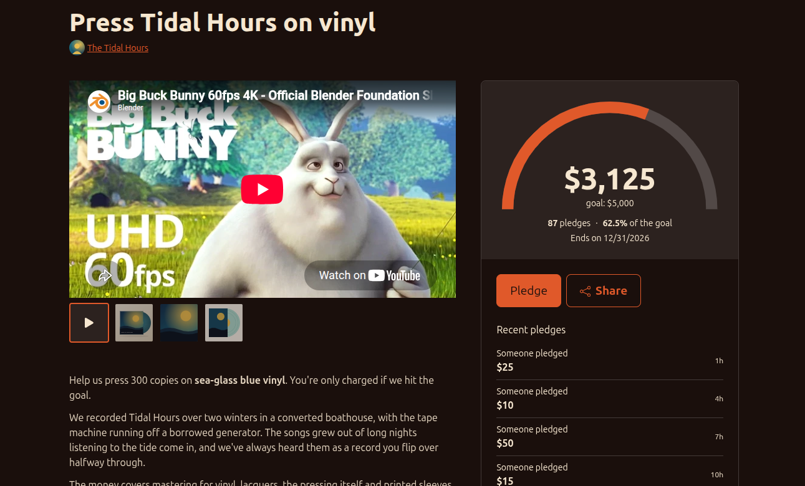

# Fundraisers

Raise money for a project — pressing vinyl, buying a van, recording
your next album — with its own page your supporters can back and
share.

A fundraiser can stand on its own or be linked to a release. Either
way it gets a public page at
`mirlo.space/your-artist/fundraiser/your-fundraiser`.

::: tip
Supporters pay through Stripe, so you need to
[set up payments](../how-tos/setting-up-an-artist-account.md) before
anyone can back your fundraiser.
:::

## Starting a fundraiser

Go to your artist's **Support** tab in the manage area and click
**Add fundraiser**. Your fundraisers are listed at the top of that
tab, each with how much it has raised so far.

You can also add a fundraiser to a release from the release editor.
The release page then shows the fundraiser's progress, and supporters
can back it from there as well as from the fundraiser's own page.

## What goes on the page

- **Name**, shown at the top of the page.
- **Description**: tell people what their money goes towards. You
  can format the text, embed YouTube or Vimeo videos, and embed your
  releases.
- **Goal** and an optional **end date**, shown with a progress ring
  on the page. Under the goal, Mirlo shows what you'd keep once the
  platform fee and Stripe's estimated fee are taken off.
- **Images**: add several and drag them into order. The first image
  is the cover, which is also used when the page is shared. Images
  are shown in a 16:9 frame.
- **Video**: paste a YouTube or Vimeo link. It's shown first, in
  the same carousel as the images.

Fundraisers start out private. Click **Make public** when the page is
ready, and **Make private** to hide it again.

The page's address is shown under the name. Click **Change URL** to
edit the last part of it, then save the fundraiser. Changing it on a
public fundraiser breaks links people have already shared.

## All-or-nothing fundraisers

Turn on **Is it all or nothing?** if you only want the money when
the goal is reached.

- Supporters **pledge** an amount and add their card. They aren't
  charged yet.
- Backers can change or cancel their pledge from the fundraiser's
  page (or the release page) until the pledges are charged.
- The smallest pledge is the smallest amount Stripe can charge in
  your currency (for example $0.50 or £0.30).
- Once the pledges add up to the goal, click **Charge pledges now**
  and confirm. Every backer is charged and gets an email saying the fundraiser was
  funded. If a card fails, that backer gets an email asking them to
  pay another way. Once the pledges are being charged, backers can no
  longer change or cancel them.
- The **Pledges** button lists everyone who has pledged.

All-or-nothing can't be turned off once someone has pledged.

## Other fundraisers

Without all-or-nothing, the page shows a button to tip you directly.
For a fundraiser linked to a release, sales of that release count
towards the goal. When you're finished, click **Mark fundraiser as
done**.

## Good to know

- The end date is shown on the page, but the fundraiser doesn't yet
  close by itself when it passes. Charge the pledges or mark the
  fundraiser done yourself.
- Tips made from a fundraiser's page don't count towards its goal
  yet.
- Removing a fundraiser asks you to confirm first, and cancels any
  pledges that haven't been charged. Its address is freed, so a new
  fundraiser can use it.
